# GameSpecMatch

**Tell it what computer you have, in your own words, and it tells you which PC games it can play, and which single
upgrade would let you play the most.**

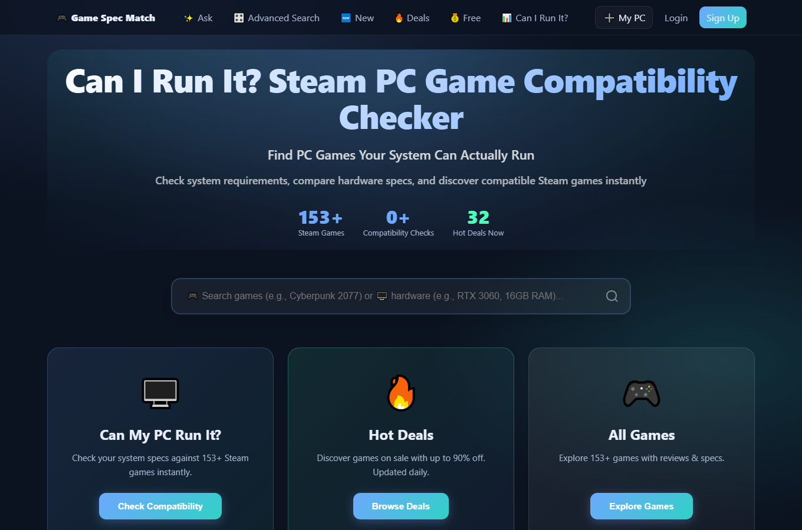

*The home page: search for a game, browse deals and free games, or press **My PC** to tell the site about your
computer.*

## What it does

Every PC game lists the computer parts it needs, but the names and numbers are hard to compare with what you own.
You describe your computer once, in everyday words, and every game page then tells you plainly whether the game will
run, at basic or full quality, and which part of your computer is too slow. You can also search in ordinary
sentences, such as "co-op survival games under $20 my PC can run", and ask which upgrade is worth buying.

## A real-life example

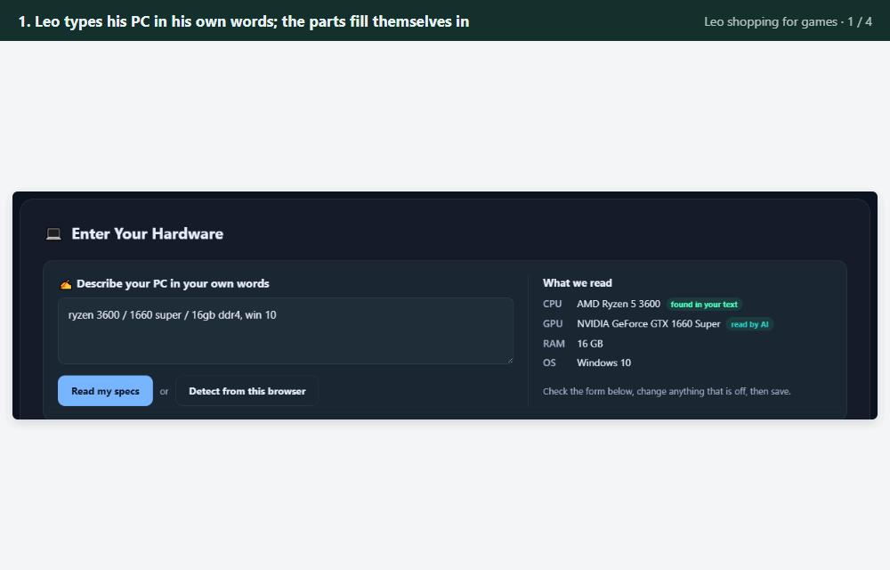

*Leo's evening of game shopping, in four steps.*

Leo has a gaming PC with a Ryzen 5 3600 processor, a GTX 1660 Super graphics card and 16 GB of memory.

- **Before:** to know whether a game will run, he opens its store page, reads the list of required parts, then
  searches online to compare his parts with names like "RTX 2060 SUPER or RX 5700 XT". He sometimes buys a game
  that turns out to run badly, and when he thinks about upgrading he has no idea which part would make the biggest
  difference.
- **With GameSpecMatch:** he types "ryzen 3600, 1660 super, 16gb ddr4, win 10" and the form fills itself in. He
  searches "co-op survival games under $20 my PC can run" and gets 66 matching games, each marked with whether his
  PC can run it. On Cyberpunk 2077 he presses **Can I Run This?** and sees that it runs at minimum settings, with
  the processor and graphics card each compared with what the game asks for.
- **After:** the upgrade page checks his PC against all 153 games, then again with each common upgrade swapped
  in, and shows which one lets him play the most extra games. In testing, it identified the processor, graphics
  card and memory correctly in all 40 sample descriptions without ever picking a wrong part, and understood 97%
  of the 36 plain-language searches exactly.

## How you would use it

1. Open the site and click **My PC**.
2. Describe your computer in your own words (for example "i5 12400f, rtx 3060, 16 gigs"), or paste the system
   information Windows shows you, then press **Read my specs**. Check the parts it found and save.
3. Open any game and press **Can I Run This?** to see whether it runs, and which part, if any, is too slow.
4. Click **Ask** and type what you feel like playing in a sentence. The results show only games that match, each
   with a "can run" verdict for your PC.
5. Open **What to upgrade** to see which single new part would let you play the most extra games.
6. Create a free account if you want your PC saved for next time.

## In technical terms

GameSpecMatch is a "Can I run it?" site for Steam PC games, built with Laravel 12 for PC gamers who want to know what
their machine can play. You describe your PC once, in your own words or by picking parts from a catalogue of about 300
CPUs and GPUs, and every game page shows whether the game runs at minimum or recommended settings and which part falls
short. Three AI features (each one a call to a large language model, the kind of AI behind chat assistants) sit on
a rule-based core (fixed, testable code that makes every final decision): reading a PC description, searching games
in plain words, and finding the upgrade that unlocks the most games. Each feature also has a rule-based path, so the
site runs fully without an API key (the password for a paid AI service).

## Key features

- **Describe your PC.** Type "ryzen 3600, 1660 super, 16 gigs", name a laptop, or paste a dxdiag or System Information
  block, and the form fills itself. Rules run first. The model is only asked about the parts they could not place, and
  its answer counts only if the part is in the catalogue and its model number is in your text.
- **Ask GameSpec.** Search in plain words: "co-op survival games under $20 my PC can run". The request becomes
  structured filters drawn from the app's own lists, MySQL applies them, embeddings rank the rest by meaning, and
  "runs on my PC" keeps only the games your saved PC passes.
- **What should I upgrade?** Your PC is checked against every game, then again with each widely sold CPU, GPU and RAM
  upgrade swapped in. Each upgrade is valued by how many extra games it lets you run. A model writes a short summary
  from those numbers, and a summary containing any number that is not in them is replaced by a template.
- **Compatibility reports.** Each game page compares your CPU, GPU and RAM with the game's minimum and recommended
  requirements, part by part, on one scoring scale shared by PCs and requirements.
- **A complete game site.** Browse, deals, free, latest and popular games, collections, advanced search with MySQL
  full-text search, a sitemap, and JSON-LD structured data on game and collection pages.
- **Accounts.** Saved PCs follow you, a PC added as a guest moves to your account when you sign in or register, and
  each saved PC is visible only to its owner.
- **Works without AI.** With no key, or with `AI_DRIVER=off`, every feature runs on its rules. With a key, model calls
  are logged and cached, and the endpoints that make them are rate-limited.

## Architecture

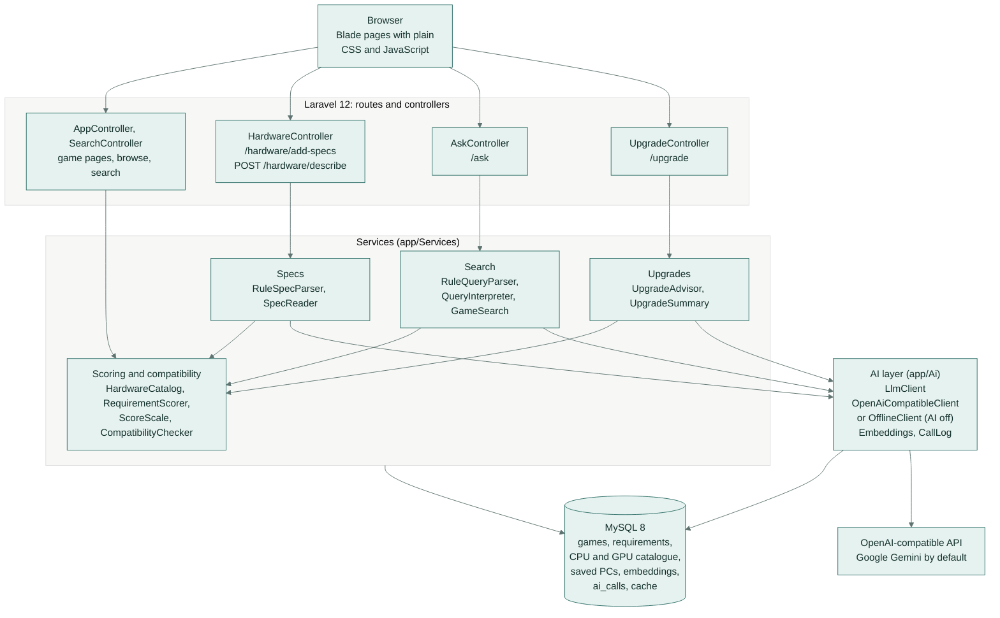

- **Controllers** serve the pages and endpoints. The controllers behind the AI features validate input and hand off to
  one service each. Web routes are in `routes/web.php`.
- **Scoring and compatibility** is the rule-based core that every feature shares. Hardware and requirements are scored
  on one scale, and one checker gives every verdict: on game pages, in search results and in the upgrade advisor.
- **The AI layer** is the only code that talks to a model. `LlmClient` is an interface with two implementations, chosen
  in `AppServiceProvider`: `OpenAiCompatibleClient` when a key is set (or `AI_DRIVER=live`), and `OfflineClient`
  otherwise, which refuses every call so each feature takes its rule path.
- **MySQL** holds the catalogue and the app's state. It also stores the embedding vectors, the `ai_calls` log and, with
  the default database cache store, cached model answers.

## How it works

### Scoring on one scale

1. **Requirements.** `php artisan games:import` (the seeder runs it) splits each game's requirement HTML into one line
   per part (`RequirementText`), finds the named CPUs and GPUs in the catalogue (`HardwareCatalog`) and scores them
   (`RequirementScorer`). Catalogue names match as whole words, longest name first, so "GTX 1660 Ti" is never read as
   "GTX 1660". A requirement that lists alternatives ("GTX 970 or RX 470") is as hard as its weaker option, since
   either one meets it. A part the catalogue does not know is estimated from its VRAM or DirectX level (GPUs), or from
   its family or clock speed (CPUs).
2. **PCs.** A saved PC is scored with the same formula (`ScoreScale`): CPU benchmark / 100, GPU benchmark / 35, RAM in
   GB, and an overall score weighted 50% GPU, 35% CPU and 15% RAM, with RAM counting fully at 32 GB.
3. **Verdicts.** `CompatibilityChecker` compares the two part by part and returns "Can Run (Recommended Settings)",
   "Can Run (Minimum Settings)" or "Cannot Run", with the parts that fall short. A part that is slightly short can be
   made up by the others within fixed margins. Memory beyond what a game asks for never makes up for a slow GPU or CPU,
   and a GPU below 70% of the minimum always means "Cannot Run".

### Describe your PC

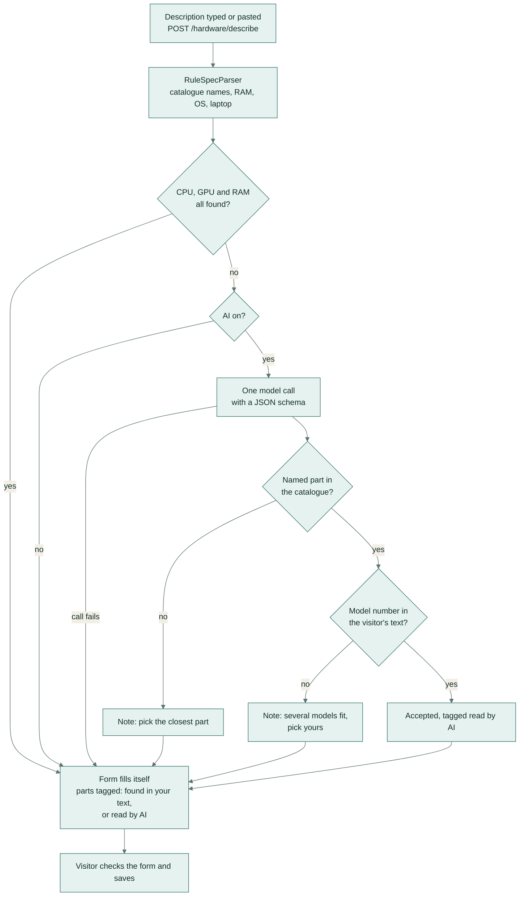

1. The visitor types or pastes up to 2,000 characters on `/hardware/add-specs`, and the page posts the text to
   `POST /hardware/describe`.
2. `RuleSpecParser` reads what it can without a model: catalogue part names, the RAM size (told apart from video memory
   and drive sizes), the operating system, and whether the PC is a laptop, in which case the GPU becomes its laptop
   version when the catalogue has one.
3. If the CPU, GPU or RAM is still missing and AI is on, `SpecReader` asks the model once, with a JSON schema. The
   system prompt treats the description as data, not instructions. Only the fields the rules left empty are taken from
   the answer.
4. A part the model names is used only if `HardwareCatalog` finds it **and** its model number appears in the visitor's
   own text. "legion 5 with a 3060" can become the RTX 3060 Laptop GPU, while "i5 4th gen" stays empty with a note
   asking the visitor to pick, instead of a guess. A RAM size is used only if the same size is in the text.
5. The form fills itself and tags each part "found in your text" or "read by AI", and the visitor checks it and saves.
   If the model call fails, the rule result comes back with a note.

**Detect from this browser** reads the graphics card from the browser's WebGL renderer string and sends it through the
same endpoint with AI off. Browsers do not expose the CPU model or the exact memory, so those stay for the visitor to
set.

### Ask GameSpec

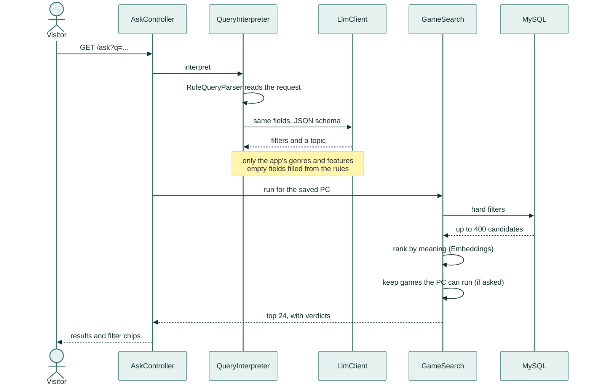

1. `RuleQueryParser` always reads the request (up to 300 characters) with patterns: prices, "free", genres, features
   such as co-op or split-screen, review level, release years, "my PC can run", "like Stardew Valley" and sort words.
   What is left becomes the topic.
2. With AI on, `QueryInterpreter` asks the model for the same fields inside a JSON schema whose genre and feature values
   are the app's own lists. Values outside those lists or out of range are dropped, a "like" title counts only if the
   game is in the catalogue, and any field the model leaves empty is filled from the rules.
3. `GameSearch` applies the hard filters in MySQL (genres, the Steam categories behind each feature, price, share of
   positive reviews, release years, no in-app purchases), keeps up to 400 candidates, and widens the genre when fewer
   than 3 games match.
4. Candidates are ranked by meaning: cosine similarity between the topic (or the game the visitor compared to) and
   each game's stored embedding, with a light popularity prior. With AI off, hashed word overlap stands in for the
   embeddings.
5. "Runs on my PC" keeps only the games the compatibility checker passes for the saved PC, at minimum or at recommended
   settings as asked, and every result shows its verdict.
6. The page shows how the request was understood, as chips, and whether AI or the rules read it.

### What should I upgrade?

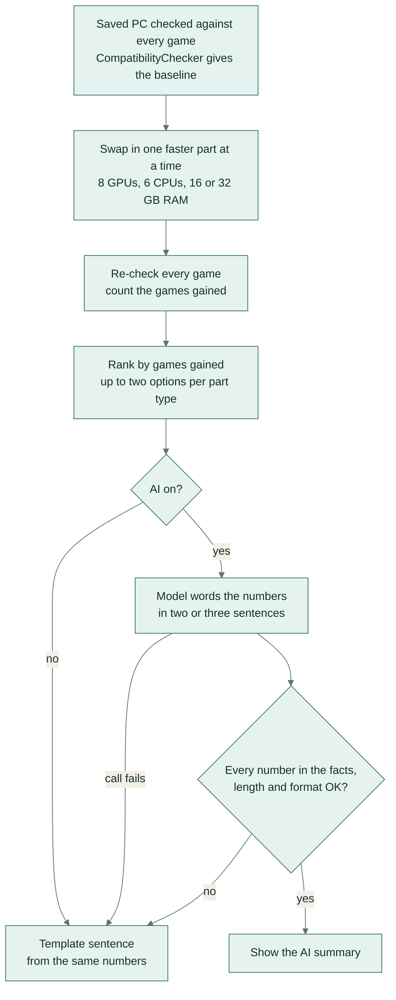

1. `UpgradeAdvisor` checks the saved PC against every game with scored requirements for its platform (the 2,000 most
   recommended at most) and records which part holds back each game that misses recommended settings.
2. It swaps in each widely sold part that is faster than the current one, one at a time, and re-checks every game with
   the same `CompatibilityChecker` the game pages use.
3. An upgrade's value is the number of extra games at recommended settings, then at minimum. The page lists up to two
   options per part type: the biggest gain, and a slower, cheaper step that still gets at least 60% of it.
4. `UpgradeSummary` gives the model those numbers as plain facts. A draft is used only if every number in it, including
   numbers written as words, appears in the facts, it is 40 to 600 characters long and it has no Markdown. Otherwise
   the page shows a template sentence built from the same numbers.
5. On a game page, "What would it take to run it well?" opens `/upgrade?game=<slug>`, which also shows, part by part,
   the slowest listed upgrade that meets that game's recommended requirements.

### The AI client

- One interface (`App\Ai\LlmClient`) covers JSON answers, plain text and embeddings. `OpenAiCompatibleClient` works
  with any OpenAI-compatible API. The default is Google Gemini's OpenAI-compatible endpoint; OpenAI, OpenRouter, Groq
  or a local Ollama work by changing `AI_BASE_URL` and the model names.
- Structured calls use temperature 0 and a JSON schema. A reply that is not valid JSON gets one repair turn, and JSON
  inside code fences is accepted.
- Requests are retried on HTTP 429, 500, 502, 503 and 504 and on connection errors, with a hard timeout
  (`AI_TIMEOUT`).
- Answers are cached under a hash of the model and everything sent (`AI_CACHE_DAYS`). Game embeddings are stored with a
  hash of their text, so an unchanged game is never embedded twice, and query embeddings are cached.
- Every provider call is logged to the `ai_calls` table with its feature, model, latency, token counts and any error,
  and so is every answer served from the cache.
- `/hardware/describe`, `/ask` and `/upgrade` are limited to 15 requests a minute per signed-in user, or per IP address
  for guests.
- A failed or unusable call raises `AiException`, and the feature falls back to its rules.

## Screenshots

**Describe your PC.** For "ryzen 3600 / 1660 super / 16gb ddr4, win 10" the rules found the CPU in the text, and the
model read "1660 super", which the catalogue and the text then confirmed.

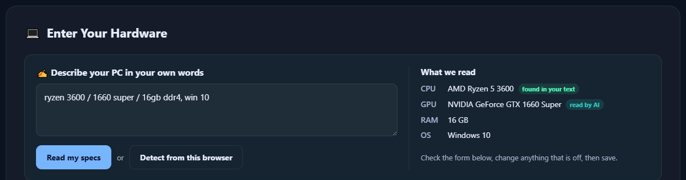

**Ask GameSpec.** "co-op survival games under $20 my PC can run", read by AI as Co-op, Under $20, Runs on your PC and
the topic "survival". 66 games pass the filters; they are ranked by embeddings, and each one shows its verdict for the
saved PC.

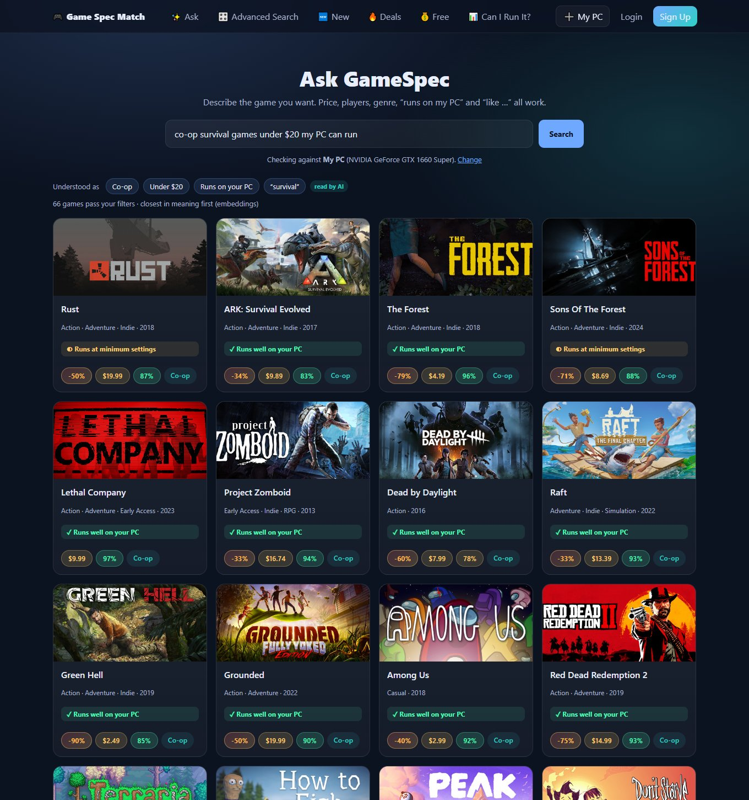

**What should I upgrade?** A Ryzen 5 3600 with a GTX 1660 Super, checked against 153 games: the summary written from
the numbers, what Cyberpunk 2077 needs at recommended settings, which part holds the PC back, and the upgrades that
help most.

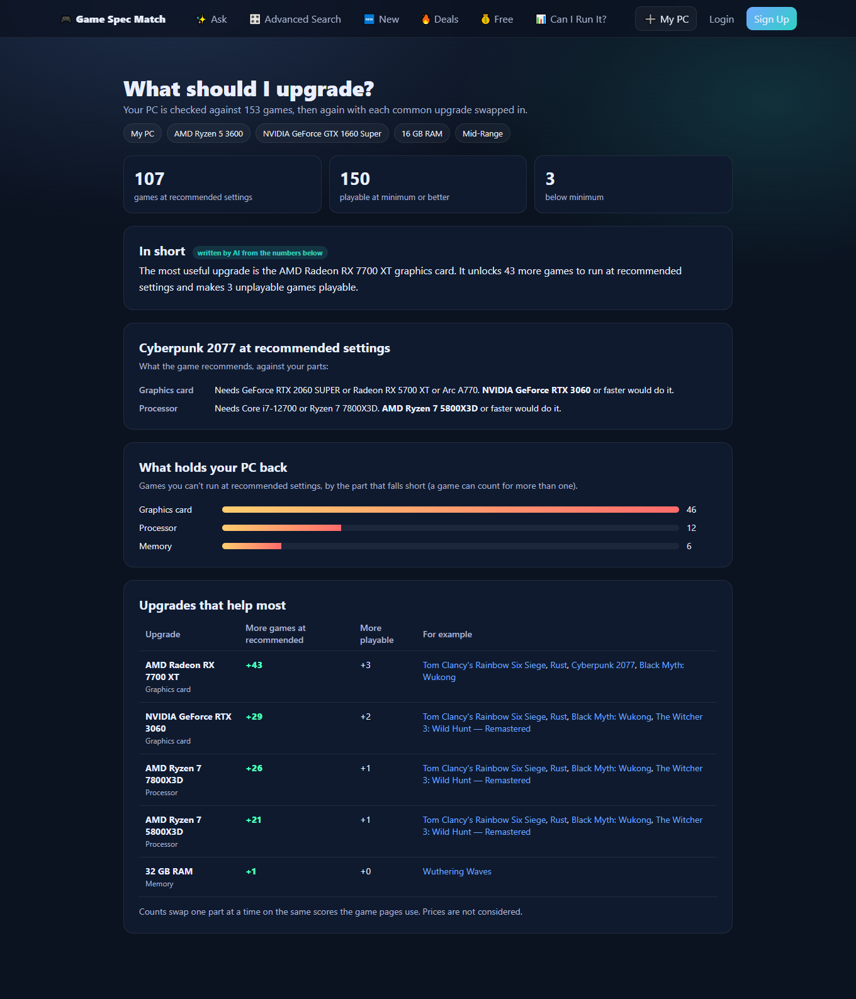

**Compatibility report.** Cyberpunk 2077 against the saved PC: each part's score next to the game's minimum and
recommended requirement.

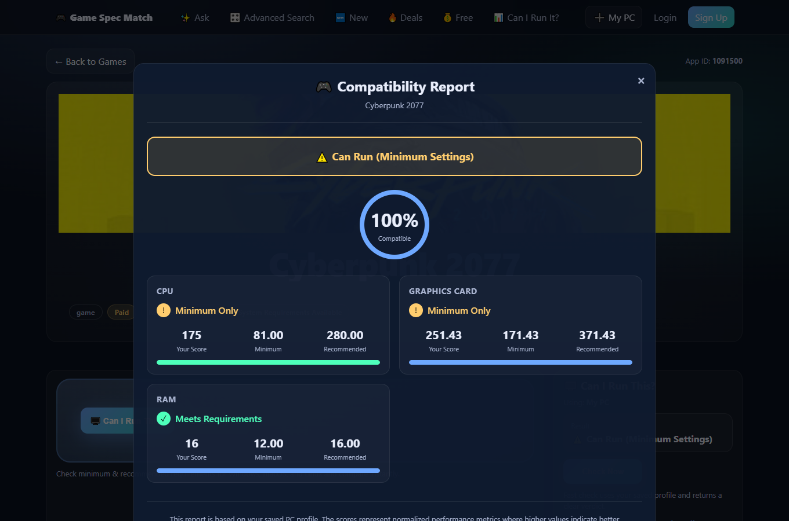

**Account.** The saved PCs, the active one used for every check, and links to the games it runs and to upgrade advice.

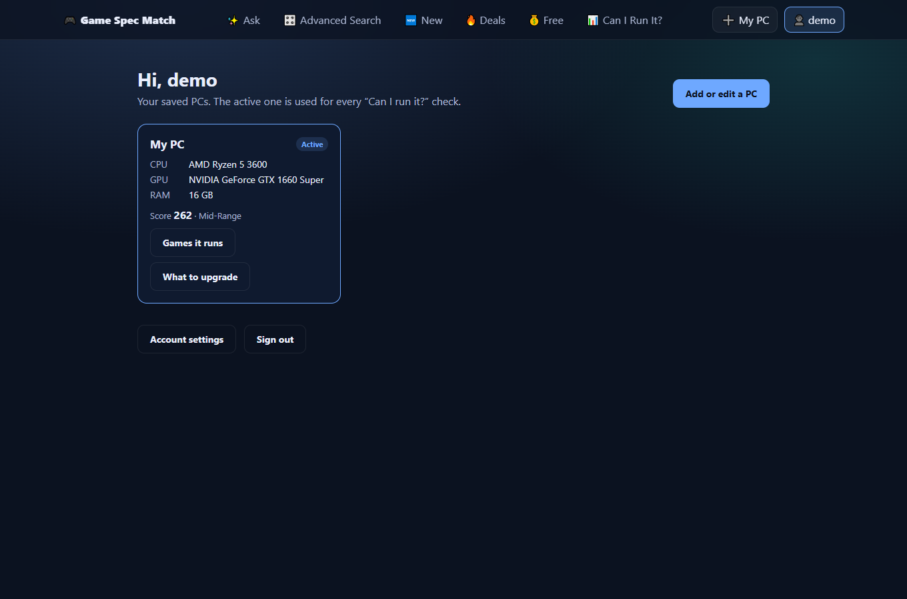

## Tech stack

| Layer | Technology |
|---|---|
| Web app | Laravel 12, PHP 8.2+ |
| Database | MySQL 8, with FULLTEXT indexes for text search |
| Front end | Blade templates with plain CSS and JavaScript, no build step |
| AI | Any OpenAI-compatible chat and embeddings API through Laravel's HTTP client; Google Gemini by default (`gemini-flash-lite-latest`, `gemini-embedding-001`) |
| Data | Steam's public store API, Python 3 scripts for the sample catalogue and the scraper |
| Tests and CI | PHPUnit 11, GitHub Actions with a MySQL 8.4 service |

## Getting started

### Prerequisites

- PHP 8.2 or newer, with the `pdo_mysql`, `mbstring` and `intl` extensions
- Composer
- MySQL 8 (search uses FULLTEXT indexes, and the tests run on MySQL)
- Optional: an API key for an OpenAI-compatible provider. A free Gemini key from Google AI Studio works with the
  default settings.

Node.js is not needed: there is no front-end build step.

### Install and run

```bash
git clone https://github.com/samiulhuda360/gamespec-match.git
cd gamespec-match
composer install
cp .env.example .env
php artisan key:generate
```

Create an empty database (`.env.example` names it `gamespec`) and set the `DB_*` variables in `.env` for your MySQL
server:

```sql
CREATE DATABASE gamespec;
```

Then build the schema, load the demo data and start the server:

```bash
php artisan migrate --seed   # hardware catalogue, 153 Steam games scored on import, demo user, collections
php artisan serve            # http://127.0.0.1:8000
```

Sign in as `demo@example.com` with the password `password`, or use the site as a guest.

### Configuration

Settings are environment variables in `.env`; `.env.example` lists them. The AI defaults below come from
`config/ai.php`.

| Variable | Purpose |
|---|---|
| `DB_HOST`, `DB_PORT`, `DB_DATABASE`, `DB_USERNAME`, `DB_PASSWORD` | MySQL connection |
| `APP_KEY` | Encryption key, set by `php artisan key:generate` |
| `APP_URL` | The site's base URL |
| `AI_API_KEY` | Key for the OpenAI-compatible provider. Leave it empty to run every feature on its rules |
| `AI_DRIVER` | `auto` (default: use AI when a key is set), `live` (always call the provider) or `off` (never call a model) |
| `AI_BASE_URL` | Provider endpoint. Defaults to Gemini's OpenAI-compatible API |
| `AI_CHAT_MODEL` | Chat model. Defaults to `gemini-flash-lite-latest` |
| `AI_EMBEDDING_MODEL` | Embedding model. Defaults to `gemini-embedding-001` |
| `AI_TIMEOUT` | Seconds before a model call is abandoned. Defaults to 20 |
| `AI_CACHE_DAYS` | Days a model answer stays cached. Defaults to 30 |
| `ADMIN_PASSWORD_HASH` | Bcrypt hash of the admin password for `/admin/login` |

### Turn on the AI features

Put a key in `AI_API_KEY` in `.env`, then embed the games once so Ask GameSpec can rank by meaning. The command is
paced for free-tier rate limits, and later runs skip games whose text has not changed.

```bash
php artisan games:embed
```

`AI_DRIVER=off` switches every feature back to its rules, even with a key set.

### Admin

```bash
php artisan admin:generate-password
```

The command prints an `ADMIN_PASSWORD_HASH=...` line to add to `.env`. Sign in at `/admin/login` to manage collections
and to see the graphics cards that browsers reported but the catalogue does not match yet.

## Usage

### Walkthrough

1. Click **My PC** (or open `/hardware/add-specs`). Describe your PC and press **Read my specs**, or press
   **Detect from this browser**, or pick the parts from the lists. Check the form and save.
2. Open any game page and press **Can I Run This?** for a part-by-part compatibility report.
   **What would it take to run it well?** opens the upgrade advice for that game.
3. Open **Ask** (`/ask`) and type what you want to play. The chips above the results show how the request was read.
4. Open `/upgrade`, or **What to upgrade** on your account page, to see which upgrade unlocks the most games.
5. Sign in to keep your PCs on an account (`/account`). A PC saved as a guest moves to the account.

### Pages and endpoints

| Route | What it does |
|---|---|
| `GET /` | Home: search, deals and collections |
| `GET /hardware/add-specs` | Add or edit your PC |
| `POST /hardware/describe` | Text in, catalogue parts out, as JSON (behind "Read my specs") |
| `POST /hardware` | Save the PC |
| `POST /hardware/check/{appId}` | Compatibility report for one game, as JSON |
| `GET /game/{slug}` | Game page: requirements, reviews, prices and screenshots |
| `GET /ask?q=...` | Ask GameSpec |
| `GET /upgrade`, `GET /upgrade?game={slug}` | Upgrade advice, optionally for one game |
| `GET /games`, `/games/free`, `/games/latest`, `/games/popular`, `/games/deals` | Browse pages |
| `GET /search/advanced` | Filters and full-text search |
| `GET /collections/{slug}` | Collection pages |
| `GET /account` | Saved PCs (signed in) |
| `GET /admin` | Admin dashboard (after `/admin/login`) |
| `GET /sitemap.xml` | Sitemap |

### Artisan commands

| Command | What it does |
|---|---|
| `php artisan games:import` | Load `database/data/steam-sample.json` and score its requirements (the seeder runs it) |
| `php artisan games:import --rescore` | Re-score every stored requirement row from its HTML |
| `php artisan games:embed` | Store one embedding per game for Ask GameSpec (`--batch`, `--pause`) |
| `php artisan ai:eval-specs --out=<file>` | Describe your PC eval: rules only, and rules with the model |
| `php artisan ai:eval-search --out=<file>` | Ask GameSpec eval: rules only, the model alone, and the model with rule backfill |
| `php artisan admin:generate-password` | Print an `ADMIN_PASSWORD_HASH` line for `.env` |
| `php artisan hardware:rescore` | Re-score saved PCs (all of them, or one with `--id=`) |
| `php artisan db:optimize --all` | Optimise tables and warm the cache (or pick `--tables`, `--cache`, `--stats`) |

The sample catalogue itself comes from `python scripts/fetch_sample_catalogue.py`, which reads Steam's public store API
(about 10 minutes, paced for Steam's rate limits) and writes `database/data/steam-sample.json`.

## Project structure

```text
app/
├── Ai/                   LlmClient interface, OpenAI-compatible and offline clients, embeddings, call log
├── Console/Commands/     games:import, games:embed, ai:eval-specs, ai:eval-search, admin and maintenance commands
├── Http/Controllers/     Hardware, Ask, Upgrade, App (game pages), Search, Account, Admin and Auth controllers
├── Models/               Eloquent models: App (a game), SysRequirement, CPU, GPU, UserHardware and more
└── Services/
    ├── Scoring/          ScoreScale, HardwareCatalog, RequirementText, RequirementScorer
    ├── Specs/            Describe your PC: RuleSpecParser, SpecReader
    ├── Search/           Ask GameSpec: RuleQueryParser, QueryInterpreter, GameSearch
    ├── Upgrades/         UpgradeAdvisor, UpgradeSummary
    ├── CompatibilityChecker.php
    └── HardwareScorer.php
config/ai.php             AI provider settings
database/
├── data/                 steam-sample.json: 153 Steam games with requirements, prices and reviews
├── eval/                 Labelled eval sets: 40 PC descriptions and 36 search requests
├── migrations/           Schema, including the ai_calls and embeddings tables
└── seeders/              Hardware catalogue, sample games, demo user and collections
docs/                     Eval reports and screenshots
resources/views/          Blade pages
routes/                   web.php for the site, auth.php for sign-in and registration
scripts/                  Python: sample catalogue fetcher, Steam scraper, standalone requirement scorer
tests/                    PHPUnit unit and feature tests
.github/workflows/ci.yml  CI
LICENSE                   MIT licence
```

## Testing

Create the test database once:

```sql
CREATE DATABASE gamespec_test;
```

Then run the suite:

```bash
php artisan test
```

`phpunit.xml` points the tests at the `gamespec_test` database (the host and credentials come from `.env`) and turns
AI off. Every test starts from the demo seed. The 72 tests cover:

- pages rendered from a fresh seed, game pages with parsed requirements, and redirects that keep the query string
- saved PCs: saving, updating, privacy (another visitor's PC returns 404), the guest-to-account hand-over and account
  deletion
- sign-in, registration, email verification, password and profile flows
- scoring: requirement parsing, whole-word catalogue matching, the weaker-alternative rule, fallbacks, and spare memory
  not making up for a slow GPU
- Describe your PC: the rules, the model asked only for missing parts, the grounding check, and the fallback when the
  model call fails
- Ask GameSpec: rule reading, filters applied to the results, allow-lists for model values, rule backfill and rate
  limiting
- upgrades: the games each upgrade unlocks, the per-game view, and the number check on the AI summary
- the AI client against a faked provider: JSON schema, fenced JSON, the repair turn, retries, caching and embedding
  order
- the eval sets, as a regression check on the rule paths

No test calls a real AI provider. Tests that need a model use the real client pointed at a faked HTTP provider.

CI (`.github/workflows/ci.yml`) runs the suite on GitHub Actions with PHP 8.2 and 8.3 against a MySQL 8.4 service, on
pushes to `main` and on pull requests.

## Evaluation

Two hand-labelled eval sets measure how the AI features read text. Each artisan command runs the same cases through
each configuration side by side, so the columns compare approaches.

**Describe your PC.** 40 descriptions in [`database/eval/pc-descriptions.json`](database/eval/pc-descriptions.json):
casual text, misspellings, laptops, dxdiag and System Information pastes, vague descriptions where the right answer is
to leave a field empty, and a prompt-injection attempt.

| Measure | Rules only (AI off) | Rules + model (what the app runs) |
|---|---|---|
| CPU right | 98% | 100% |
| GPU right | 85% | 100% |
| RAM right | 100% | 100% |
| CPU, GPU and RAM all right | 85% | **100%** |
| Wrong CPU or GPU selected | 0 | **0** |
| Descriptions that needed a model call | 0 of 40 | 12 of 40 |

A wrong part is counted apart from a plain miss because it is the costly error: an empty field is visible to the
visitor, while a wrong part may go unnoticed.

**Ask GameSpec.** 36 requests in [`database/eval/search-queries.json`](database/eval/search-queries.json): filters,
"like ..." comparisons, runs-on-my-PC wording, phrasing outside the rule patterns ("won't melt my old laptop",
"doesn't cost a thing", "rated at least 90% positive") and a prompt-injection attempt. A field is right when it matches
the label exactly, including staying empty when the request does not ask for it.

| Measure | Rules only (AI off) | Model alone (no rule backfill) | Model + rule backfill (what the app runs) |
|---|---|---|---|
| Every filter right | 83% | 97% | **97%** |

Per-field scores and every miss are in the reports: [docs/eval-describe-your-pc.md](docs/eval-describe-your-pc.md) and
[docs/eval-ask.md](docs/eval-ask.md). Both were run on 2026-10-05 with `gemini-flash-lite-latest`, and no model call
failed in either run. To run them again (with no `AI_API_KEY`, only the rules column is measured):

```bash
php artisan ai:eval-specs  --out=docs/eval-describe-your-pc.md
php artisan ai:eval-search --out=docs/eval-ask.md
```

The rules-only scores are also part of the test suite (`tests/Unit/EvalSetsTest.php`): CI fails if Describe your PC
drops below 85% or selects a wrong part, or if Ask GameSpec drops below 83%.

## Design choices and scope

- **Rules first, model second.** Every AI feature works with AI off, and the model only fills what the rules leave
  open, so a model call is made only when there is a gap (12 of the 40 eval descriptions needed one).
- **The model never picks anything the app cannot check.** Parts must be in the catalogue and in the visitor's text,
  search filters must come from the app's own lists, and the numbers in a summary must come from the facts it was
  given.
- **Counting, not guessing.** Upgrade advice comes from re-running the same compatibility check, and the model only
  words the result. Prices are not part of the advice.
- **Tiers, not frame rates.** Benchmark scores are approximate. The verdicts say whether a game runs at minimum or
  recommended settings, not how many frames per second it reaches.
- **Ranking in PHP.** Search ranks at most 400 filtered candidates in PHP, which suits the 153-game sample; a catalogue
  of the whole Steam store would use a vector index.
- **What a browser can see.** Browser detection reads only the graphics card and the operating system.
- **Eval scope.** The eval sets are small (40 and 36 cases) and score how text is read; search ranking quality is not
  scored.

## Licence

MIT. See [LICENSE](LICENSE). Copyright (c) 2026 Samiul Huda. Game names, descriptions and images come from Steam's public store API and belong
to their owners; this project is not affiliated with Valve.
